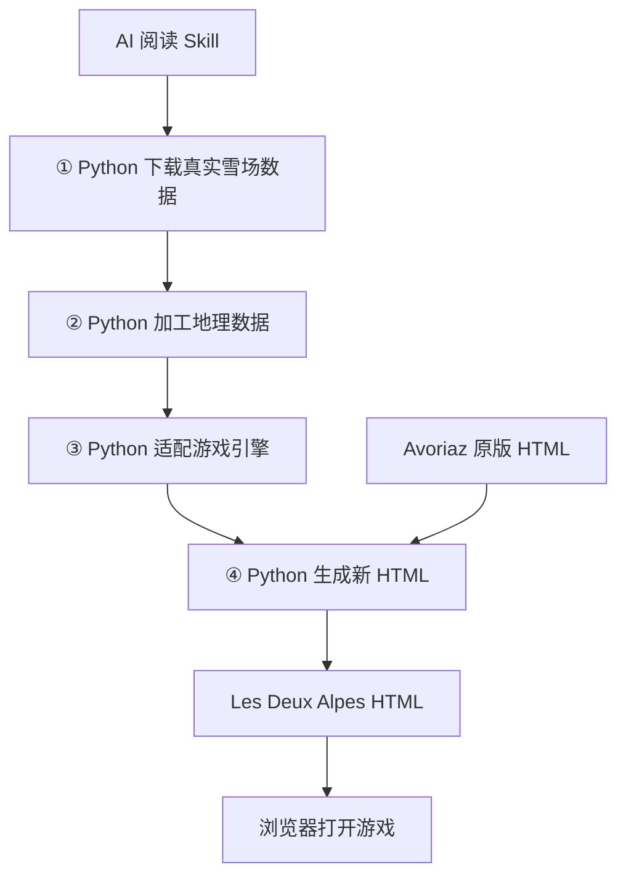
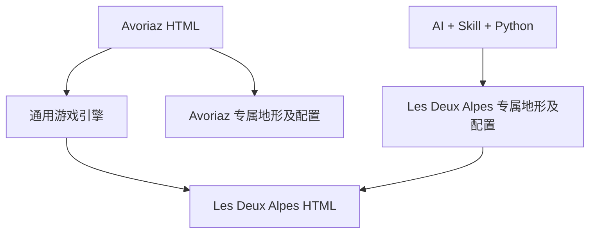

# FR Ski Simulator

把真实的法国滑雪场做成可以在浏览器里玩的 3D 滑雪游戏。

目前以 [Avoriaz 游戏](https://avoriaz.manus.space/) 为模板，利用其作者的 Skill 制作 Les Deux Alpes（双阿尔卑斯）滑雪场游戏。

## 一、制作游戏需要什么？

两个最重要的基础材料：

- **[ski-resort-to-game Skill](https://github.com/awoele/ski-resort-to-game)**：作者提供给 AI 的制作说明书和工具箱，里面包含获取、加工真实雪场数据的 Python 脚本。
- **Avoriaz HTML**：已经制作好的游戏，里面包含游戏引擎、滑雪动作、界面、地形和雪道。

AI 阅读 Skill，调用其中的 Python 脚本，再根据实际需要编写新的 Python 脚本，把 Avoriaz 改造成 Les Deux Alpes 游戏。

## 二、Python 是什么时候用的？

Python 主要用于制作游戏，而不是玩游戏。

| 步骤 | 工作内容 | Python 脚本 |
|---|---|---|
| ① 下载真实雪场数据 | 从 OpenStreetMap 获取雪道、缆车、建筑等数据，从 Terrarium 或 IGN 获取山体高程 | `fetch_osm.py` / `fetch_dem.py` |
| ② 加工地理数据 | 转换坐标、计算海拔、坡度和雪道长度，把地图转换成游戏数据 | `build_data.py` |
| ③ 适配 Avoriaz 游戏引擎 | 把 Les Deux Alpes 数据转换成原版引擎能够识别的格式 | [legacy_adapter.py](scripts/legacy_adapter.py) |
| ④ 生成新的 HTML 游戏 | 替换原版 HTML 的地形、雪道、地名及相关代码 | [build_preview.py](scripts/build_preview.py) / [expand_preview.py](scripts/expand_preview.py) |

前两个步骤使用作者 Skill 中的脚本，后两个步骤使用本项目开发的脚本。



Python 可以在 GitHub Actions 的云端电脑上运行。玩家只需要打开生成的 HTML，不需要安装 Python。

## 三、HTML 游戏里面包含什么？

这个项目采用单文件 HTML 游戏：把游戏代码、界面、数据和资源封装在一个文件里。

| 组成 | 包含的内容 | 更换雪场时 |
|---|---|---|
| HTML | 开始按钮、菜单、地图、速度表、计时器 | 主要保留 |
| CSS | 字体、颜色、布局、动画、手机横屏界面 | 主要保留 |
| JavaScript | 3D 渲染、滑雪物理、人物动作、碰撞、天气、相机、缆车、音效 | 复用为主 |
| JSON 地理数据 | 山体高程、雪道坐标、缆车、建筑物、出生点 | 重点替换 |
| 游戏资源 | 内嵌图片、字体，以及代码生成的模型和声音 | 部分替换 |
| 雪场专属配置 | 雪场名称、地标、路线选择、语言、地图边界 | 重点修改 |

Avoriaz 原版 HTML 大约 9.53 MB，其中核心雪场地理数据约 4.98 MB，占整个文件的一半以上。

浏览器中的 JavaScript 负责运行游戏，WebGPU 或 WebGL2 负责绘制实时 3D 画面。

## 四、真实雪山是如何生成的？

DEM（数字高程模型）可以理解成一张山体网格，每个网格点记录真实海拔。

OpenStreetMap（OSM）则提供真实雪道、缆车和建筑物的位置。

Python 将这些数字加工后写入 HTML，游戏引擎再根据这些数字绘制 3D 雪山。

原版 HTML 中有一个重要的数据区域，叫作 `AVZ_DATA`。下面是简化示意：

```javascript
const AVZ_DATA = {
    grids: ...,       // 山体高程网格
    pistes: ...,      // 雪道
    lifts: ...,       // 缆车
    buildings: ...,   // 建筑
    courses: ...,     // 计时路线
    mask: ...,        // 地表区域掩码
    origin: ...,      // 地理坐标原点
};
```

Python 的核心工作之一就是替换这里面的数据，同时修改原游戏中与 Avoriaz 绑定的逻辑。

## 五、Avoriaz 与 Les Deux Alpes 游戏有什么区别？

| 内容 | Avoriaz 原版 | Les Deux Alpes v0.2 |
|---|---:|---:|
| HTML 文件大小 | 9.53 MB | 5.12 MB |
| 内嵌雪道分段 | 144 | 143 |
| 内嵌缆车线路分段 | 20 | 18 |
| 建筑数据 | 512 | 722 |
| 初始计时路线 | 9 | 8 |
| 近景地形网格间距 | 5 m | 30 m |
| 游戏引擎 | 原版 | 复用并适配 |
| 雪场地理数据 | Avoriaz | Les Deux Alpes |

目前新游戏文件更小，主要因为地形数据较粗、移除了原雪场图片。30 米网格还没有达到 Avoriaz 原版的地形细节。

v0.2 已写入八条候选路线：Demoiselles、Petites Crêtes、Clot des Fonds、Jandri 1、Thuit 2、Vallons du Diable、Diable 1 和 Diable 2。

**当前仍是工程测试版。** 真实数据与 JavaScript 语法已通过检查，但实际游玩尚未验证，Demoiselles 的坡度也需要复核。这是早期 v0.2 的记录；后续版本已实现自动取得并校验原版模板。

## 六、最终目标



把通用游戏引擎与雪场专属数据逐渐分离。

以后制作 Alpe d'Huez、Val Thorens、Tignes 等其他法国雪场时，希望主要通过更换地理数据和配置来完成，而不用每次重新编写整个游戏。通用生成器的第一阶段已完成：新增雪场先在 `resorts/` 下建立自己的 `config.json`（名称、真实地图范围、数据来源等），再通过统一的 [build_game.py](scripts/build_game.py) 生成 HTML，或在 [GitHub Actions](https://github.com/lzcjames/fr-ski-simulator/actions) 选择 `Generate resort preview`。目前 Les Deux Alpes 和 Alpe d'Huez 已通过同一份通用引擎生成各自的 HTML。Engine v1.1 的 10/20/60 米独立 Terrarium 地形与 WebGL2 基础操作测试均已通过；完整雪道滑行及真实手机验证仍待完成。Engine v1.2 已通过 IGN 5/20/60 米地形验证和桌面 WebGL2 基础操作测试，v1.1 的手机横竖屏模拟测试也已通过。Engine v1.3 的无损高程压缩和 IGN 版手机横竖屏模拟测试全部通过：Les Deux Alpes 约 7.21 MB，Alpe d'Huez 约 7.29 MB。当前正在评估可选轻量启动模式。新增雪场仍需先配置真实地图范围。

引擎优化说明：[Engine v1](docs/engine-v1.md) · [分层地形](docs/engine-v1.1-terrain.md) · [IGN 试验](docs/engine-v1.2-ign.md) · [手机性能测试](docs/mobile-performance.md)。

详细方法见 [多雪场生成器](docs/multi-resort-generator.md)。

游戏构建成果：[Engine v1.3 测试与下载](https://github.com/lzcjames/fr-ski-simulator/actions/runs/45505895867)。

## 项目文件与技术资料

- [GitHub Actions](https://github.com/lzcjames/fr-ski-simulator/actions)：自动运行 Python、构建及测试游戏。
- [雪场配置](resorts/les-deux-alpes/config.json)
- [引擎适配及复现方法](docs/engine-adaptation.md)
- [真实雪场数据报告](docs/les-deux-alpes-data-checkpoint.md)
- [v0.1 单路线测试版](docs/engine-preview-v0.1.md)
- [v0.2 多路线测试版](docs/multiroute-preview-v0.2.md)

## 来源与署名

感谢 [Cold Smoke](https://github.com/huiskylabs/cold-smoke)、[Avoriaz 游戏](https://avoriaz.manus.space/) 及 [awoele 的 Skill](https://github.com/awoele/ski-resort-to-game)。地理数据来自 [OpenStreetMap contributors](https://www.openstreetmap.org/copyright)、[AWS Terrain Tiles](https://registry.opendata.aws/terrain-tiles/)，Engine v1.2 使用 [IGN RGE ALTI](https://www.data.gouv.fr/datasets/rge-alti-r)（Licence Ouverte 2.0）数值高程服务。

本项目为独立模拟游戏，并非雪场官方产品或现实滑雪导航工具。暂未选择项目整体许可证，第三方代码和数据仍遵循各自的许可与署名要求。
